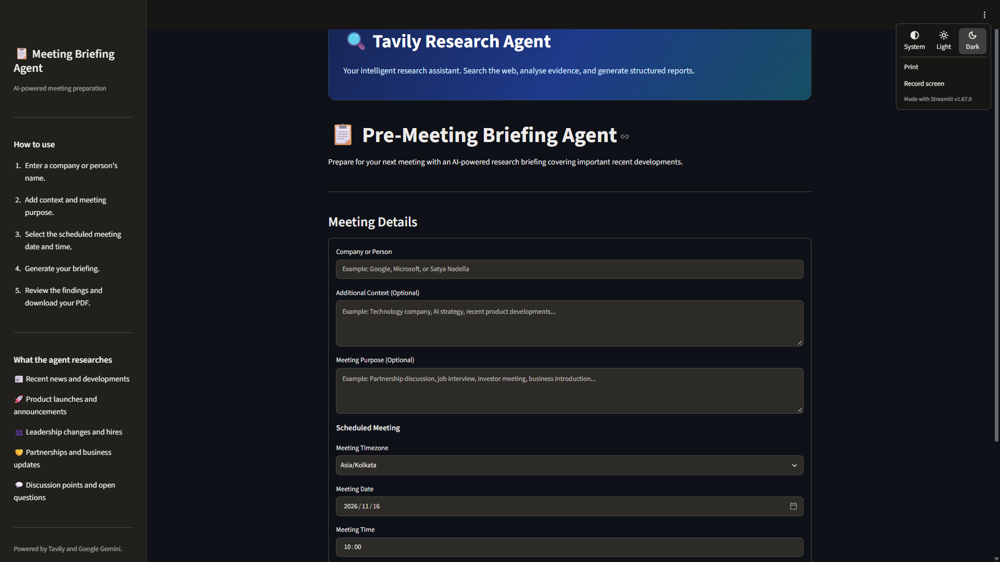
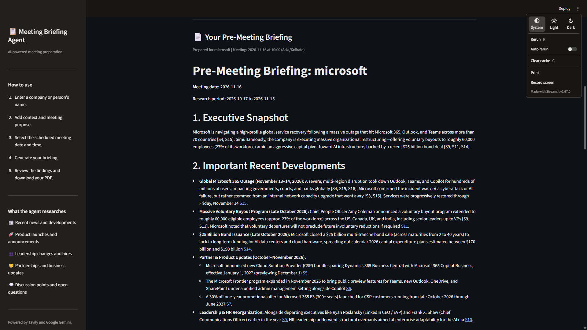
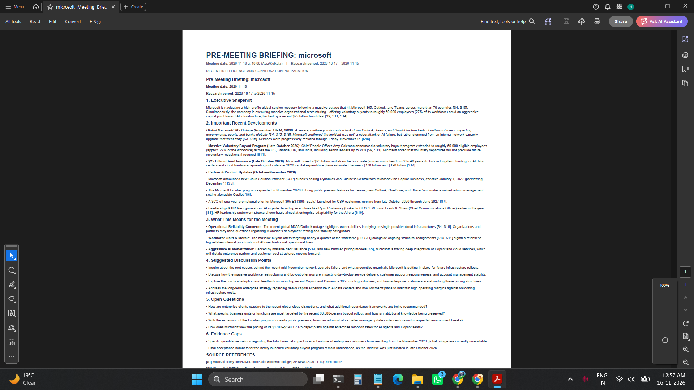

# 🔍 Pre-Meeting Briefing Agent

**Walk into every meeting already knowing what happened this month.**

An AI-powered research assistant that gathers recent information about a company or individual and transforms it into a structured, source-backed meeting briefing.

Built for **PS05 – Pre-Meeting Briefing Agent | AI Hackathon 2026**

---

## 🚀 Overview

Preparing for an important meeting often requires searching through multiple websites, news articles, announcements, and business updates.

The Pre-Meeting Briefing Agent simplifies this process.

Simply enter the company or person's name, provide the meeting context and purpose, and let the application research relevant developments from the previous 30 days.

It analyses the collected information and generates a structured briefing to help users understand recent developments, identify important discussion points, and prepare meaningful questions before a meeting.

## ✨ Key Features

- **Automated Web Research:** Uses Tavily Search API to gather relevant information from multiple web sources.
- **Focused Search Queries:** Generates six targeted research queries to explore different aspects of a company or individual's recent activities.
- **30-Day Research Window:** Focuses on recent developments relevant to the upcoming meeting.
- **Source Collection:** Collects and organizes research sources while removing duplicate URLs.
- **AI-Powered Analysis:** Uses Google Gemini to analyse collected evidence and generate an actionable briefing.
- **Meeting-Specific Insights:** Considers the meeting context and purpose when preparing the report.
- **Structured Briefing:** Organizes findings into clear sections.
- **PDF Export:** Generates a downloadable PDF version of the briefing.
- **Evidence Gaps:** Highlights areas where available information is limited or insufficient.
- **Source Transparency:** Includes research sources so users can independently verify important information.

## 🧠 How It Works

The application follows a research and analysis workflow:

1. **Enter Meeting Details**

   Provide the company or person's name, meeting date and time, timezone, context, and meeting purpose.

2. **Generate Research Queries**

   The system prepares six focused search queries based on the meeting subject.

3. **Collect Recent Information**

   Tavily searches the web and retrieves relevant sources within the research window.

4. **Filter and Organize Evidence**

   The application filters dated results, removes duplicate URLs, and organizes the collected research.

5. **Analyse with Gemini**

   Google Gemini processes the collected evidence and generates insights relevant to the meeting.

6. **Generate the Briefing**

   The application presents the final report and provides an option to export it as a PDF.

## 📊 What's Included in the Briefing?

The generated briefing is organized into the following sections:

| Section | Description |
|---|---|
| Executive Snapshot | A concise overview of the subject |
| Important Recent Developments | Relevant news, announcements, and updates |
| What This Means for the Meeting | Analysis of the developments in meeting context |
| Suggested Discussion Points | Topics worth discussing during the meeting |
| Open Questions | Questions that could lead to meaningful discussion |
| Evidence Gaps | Areas where available research is limited |
| Research Sources | Links to the collected information |

## 🛠️ Technology Stack

| Technology | Purpose |
|---|---|
| Python | Core application logic |
| Streamlit | Interactive web application |
| Tavily Search API | Web research and information retrieval |
| Google Gemini API | AI-powered analysis and briefing generation |
| ReportLab | PDF generation |

## ⚙️ Installation and Setup

Follow these steps to run the application locally.

### 1. Clone the Repository

```bash
git clone https://github.com/satvik0297-del/pre-meeting-briefing-agent.git
```

### 2. Navigate to the Project Directory

```bash
cd pre-meeting-briefing-agent
```

### 3. Create a Virtual Environment (Recommended)

```bash
python -m venv venv
```

Activate it on Windows:

```bash
venv\Scripts\activate
```

### 4. Install Dependencies

```bash
pip install -r requirements.txt
```

### 5. Configure API Keys

Create a folder named `.streamlit` in the project directory if it does not already exist.

Inside it, create a file named `secrets.toml`.

Add your API keys:

```toml
TAVILY_API_KEY = "your_tavily_api_key"
GEMINI_API_KEY = "your_gemini_api_key"
```

You can obtain the API keys from:

- [Tavily](https://tavily.com/)
- [Google AI Studio](https://aistudio.google.com/)

**Important:** Never commit your API keys or secrets file to a public GitHub repository.

### 6. Run the Application

```bash
streamlit run app.py
```

The application will open in your browser.

## 💡 Example Use Cases

The agent can be used to prepare for meetings involving:

- Company research and business development.
- Executive and leadership briefings.
- Technology and industry updates.
- Recent product launches and announcements.
- Competitive research.
- Understanding an individual's recent professional activities.

### Example Research Subjects

Some example subjects for exploring the application include:

- NVIDIA and Jensen Huang
- Microsoft and Satya Nadella
- Google and Sundar Pichai

These examples cover both company-level and individual-level research.

## 🖥️ Application Preview

Screenshots of the application will be added here.

### 1. Application Interface



### 2. Generated Meeting Briefing



### 3. PDF Report




## ⚠️ Limitations

- Research quality depends on the availability and relevance of information returned by Tavily.
- Lesser-known companies or individuals may have fewer publicly available sources.
- Some web sources may not provide reliable publication dates.
- AI-generated analysis should be reviewed before being used for important business decisions.
- Users should verify critical information through the original source links.

## 🔮 Future Improvements

Potential improvements include:

- More advanced source credibility assessment.
- Interactive charts and visual summaries in PDF reports.
- More detailed company and competitor analysis.
- Improved research coverage for lesser-known entities.
- Meeting-specific recommendations and deeper contextual analysis.

## 👥 Team

**Team Members**

- Satvik Kapoor
- Raj Aryan Mago

## 📌 Project Information

| Detail | Information |
|---|---|
| Project | Pre-Meeting Briefing Agent |
| Hackathon | AI Hackathon 2026 |
| Problem Statement | PS05 – Pre-Meeting Briefing Agent |
| Repository | [GitHub Repository](https://github.com/satvik0297-del/pre-meeting-briefing-agent) |
| Application | [Launch Web App](https://pre-meeting-briefing-agent-dhh6uan5vmblwcmnnq9mhr.streamlit.app/) |

---

**Built to make meeting preparation faster, smarter, and more informed.**
